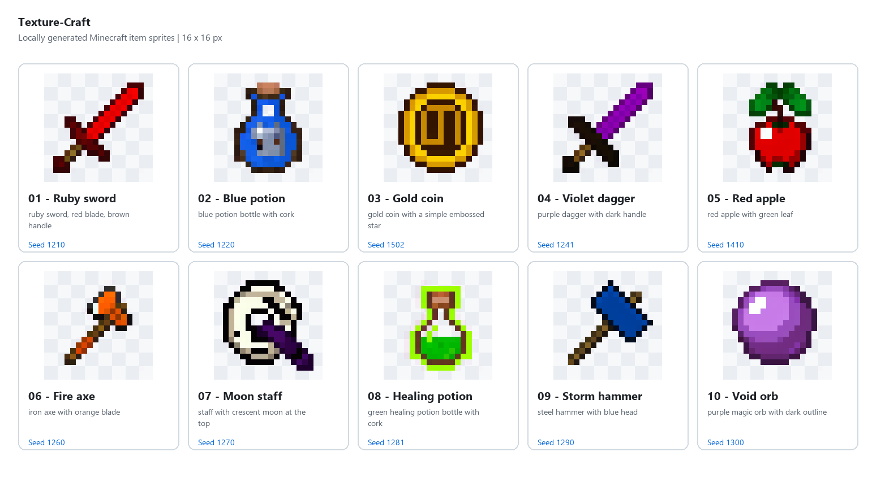
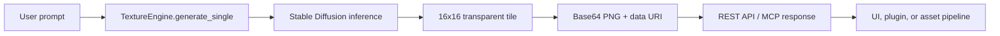

# Texture-Craft

Texture-Craft generates transparent 16x16 item textures from text prompts using a diffusion model. It offers local REST and stdio MCP workflows, plus a Gradio Space with MCP tools.

## Features

- Generate one or multiple texture variants from a prompt
- Export each tile as base64 PNG or data URI
- Remove magenta and edge-connected flat backgrounds, keeping transparent PNG output
- Detect GPU/CPU runtime status via the health endpoint
- Expose the generation flow through MCP for agent tooling

## Example textures

These prompts were used for the freshly generated sample gallery:

- "ruby sword, red blade, brown handle"
- "blue potion bottle with cork"
- "gold coin with a simple embossed star"
- "purple dagger with dark handle"
- "red apple with green leaf"
- "iron axe with orange blade"
- "staff with crescent moon at the top"
- "green healing potion bottle with cork"
- "steel hammer with blue head"
- "purple magic orb with dark outline"

Generated textures are 16x16 RGBA PNGs. Background transparency is inferred from the image edges, in addition to the model's magenta chroma-key. A checkerboard in the gallery represents transparent pixels.
This works best for flat or repeating backgrounds; complex backgrounds or an item touching the image corners may still need manual cleanup.

## Example output gallery

The model was run locally and generated a 10-item example collage. The raw files are stored in the `examples/` folder.



A few individual examples from the set:


## Example workflow



## Quick start

```powershell
uv sync
python server.py
```

Then open: http://127.0.0.1:8000/docs

## Generate a texture

```bash
curl -X POST http://127.0.0.1:8000/v1/textures/generate \
  -H "Content-Type: application/json" \
  -d '{
    "prompt": "ruby broadsword with glowing runes",
    "variants": 2,
    "seed": 42,
    "steps": 30,
    "guidance_scale": 9.0
  }'
```

Example response:

```json
{
  "prompt": "ruby broadsword with glowing runes",
  "count": 2,
  "results": [
    {
      "variant_index": 1,
      "seed": 42,
      "latency_sec": 1.7,
      "base64_png": "iVBORw0KGgoAAAANSUhEUgAA...",
      "data_uri": "data:image/png;base64,iVBORw0KGgoAAAANSUhEUgAA..."
    }
  ]
}
```

## Local stdio MCP usage

```json
{
  "mcpServers": {
    "texture-craft": {
      "command": "C:\\path\\to\\Texture-Craft\\.venv\\Scripts\\python.exe",
      "args": ["C:\\path\\to\\Texture-Craft\\local_mcp_server.py"]
    }
  }
}
```

The local server uses FastMCP and exposes the `generate_texture` tool. REST stays available through `python server.py`; the Hugging Face Space runs `app.py` and uses Gradio's built-in MCP server.

## Example MCP calls

```python
from mcp import ClientSession

# Example tool call payload
payload = {
    "prompt": "frost potion with blue crystal glow",
    "variants": 1,
    "seed": 123,
    "steps": 30,
    "guidance_scale": 9.0,
}
```

## Hugging Face Space

The root README metadata configures this repository as a Gradio Space. For deployment steps, ZeroGPU setup, MCP endpoint verification, usage limits, and model licensing, see [Hugging Face Space deployment](./docs/HUGGING_FACE_SPACE.md).

The Space exposes only texture generation. It does not create resource packs or accept caller-supplied filesystem paths.

## License and model

The application code is MIT-licensed. The model weights use the Stable Diffusion 1.5 / CreativeML OpenRAIL-M license; review and comply with the model's usage restrictions before deploying or using generated results. No Hugging Face token is required for the public model.

You can also call the local MCP tool with a prompt like:

- "golden wand with arcane sparkle"
- "shadow blade with dark violet accents"
- "emerald crystal shard with subtle glow"

These generate clean item-style textures ready to use in game asset pipelines.
