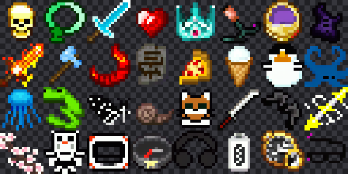
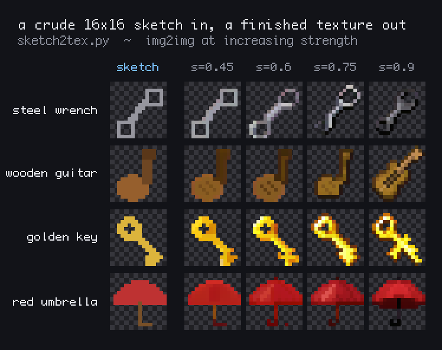
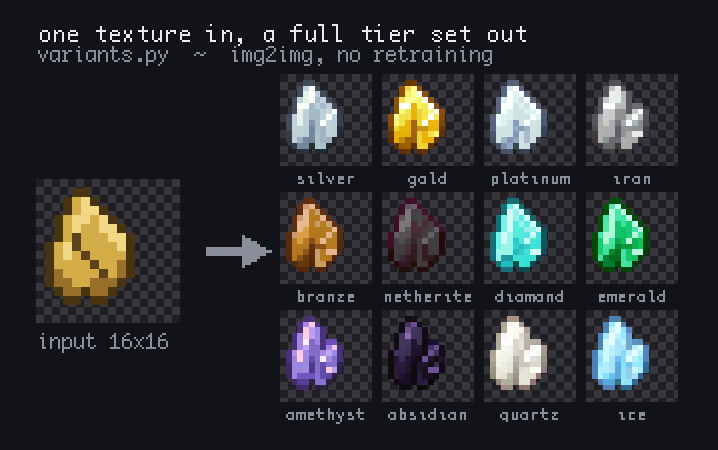

# pixelgen

Training and tooling for **[minecraft-item-16px](https://huggingface.co/yuuki14202028/minecraft-item-16px)**
— a Stable Diffusion 1.5 fine-tune that generates real 16×16 Minecraft mod item textures with
transparency, from free-text prompts.

Not "pixel-art style illustrations". Actual 16×16 RGBA sprites you can drop into a resource pack.



It also works from a drawing. `sketch2tex.py` takes a crude 16×16 doodle and finishes it —
same weights, img2img, nothing retrained:



## Why this works

Stable Diffusion cannot generate a 16×16 image. Its VAE compresses by 8×, so a 16px image
becomes a 2×2 latent, and the UNet's three downsampling stages need at least 8×8. So you have
to draw small content on a big canvas and fold it back.

The trick is to make the fold lossless. Every training image is a 16×16 texture upscaled ×16
with nearest-neighbour, so it consists of 16×16 flat blocks of 16×16 pixels. The model only
ever learns to draw on that grid, and block-averaging the 256px output recovers the sprite
exactly. Transparency rides along as magenta (255, 0, 255) and is keyed out afterwards — that
colour appears in only 0.057% of opaque training pixels, where black would collide with item
outlines in 23% of images.

## Quick start

```bash
uv sync
python sample.py --unet <path-or-hub-id> --out mytextures --prompt "copper sword"
```

Or straight from the Hub — see the
[model card](https://huggingface.co/yuuki14202028/minecraft-item-16px) for a self-contained
snippet.

**Generation settings that matter:** 256×256, guidance 9.0, 30 steps, and an **empty negative
prompt**. Training used caption dropout to an empty string, so that is the model's
unconditional path; non-empty negatives contain words absent from the 11,613-word training
vocabulary and only inject noise. Measured: `usb drive` and `cat` never resolve with the usual
`"blurry, photo, watermark…"` negative, at any guidance scale, and both work with an empty one.

## Scripts

| file | what it does |
|---|---|
| `prepare_data.py` | parquet → item-only 16×16 array + captions from file names |
| `train.py` | full UNet fine-tune, VAE latents cached, min-SNR weighting, resumable |
| `sample.py` | generate → fold to 16×16 → chroma-key the magenta background |
| `mcpixel.py` | grid detection, downscale, background cutout, contact sheets |
| `probe.sh` | fixed-seed evaluation set, for comparing checkpoints |
| `explore.py` | 50 prompts × 2 seeds across six themes |
| `sketch2tex.py` | hand-drawn 16×16 sketch → finished texture (img2img) |
| `variants.py` | tier sets, reinterpretation of existing textures, jitter, sketches |
| `RUNPOD.md` | how the training run was actually executed |

## Training

369,342 item textures, 4 epochs, 92,335 steps at batch 16, lr 1e-5 cosine, min-SNR γ=5,
10% caption dropout. One RTX 4090, 6.2 hours, 66.8 img/s. VAE and CLIP text encoder frozen;
only the 859.5M UNet was trained.

```bash
python prepare_data.py --parquet-dir <dir> --out data
python train.py --data data --out runs/mc-item --bs 16 --lr 1e-5 --epochs 4
```

Loss went 0.01192 → 0.00858 and flattened in the final quarter as the cosine schedule decayed,
so four epochs was about right for this setup.

## What it can and cannot do

Measured over 50 prompts × 2 seeds plus a 20-prompt × 3-seed diagnostic set.

Material × form composition is essentially perfect, including combinations that never co-occur
in training — `glass hammer` and `copper crown` both hit 3/3. Objects that do not exist in
Minecraft work well when the word appears in the caption vocabulary: coffee cup, donut,
syringe, umbrella, penguin, jellyfish, torii gate, katana. Even abstract prompts like
`black hole` and `rainbow` produce sensible sprites.

Concepts with zero vocabulary support fall back on the SD1.5 prior and hit around 2 in 3
(`guitar`, `microscope`). Fine modifiers like "tiny" and "rusty" are often dropped. Roughly
10–15% of generations fill the whole frame, leaving the chroma key nothing to remove.

**Judge by hit rate, never by one image.** Seed variance is large enough to mislead. During
development `steel ingot` looked broken until four seeds showed 3/4 correct, and `banana`
looked impossible until six seeds showed 5/6 correct.

## img2img covers the gaps

The model's weakness is the *shape* of unfamiliar objects, not texture or shading. Supplying
the shape yourself fixes it — `sketch2tex.py` turns a crude 16×16 doodle into a finished item,
and `variants.py` builds matched tier sets from one design, reinterprets existing textures, and
produces controlled variation for filling out a pack.



## Data provenance

Trained on [`OVAWARE/16xModdedMinecraft`](https://huggingface.co/datasets/OVAWARE/16xModdedMinecraft),
a gated dataset of textures scraped from Modrinth mods. **It carries 235 distinct license
values, including all-rights-reserved.** Generated outputs may resemble existing mod assets;
verify originality before redistributing. See the model card for the full statement.

## License

Code in this repository: MIT. Model weights: CreativeML OpenRAIL-M, inherited from Stable
Diffusion 1.5.
