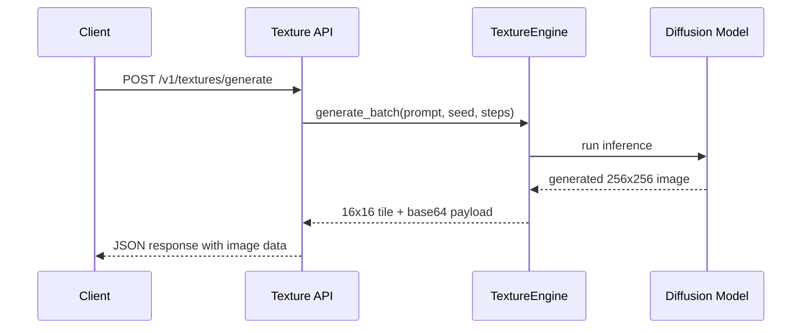
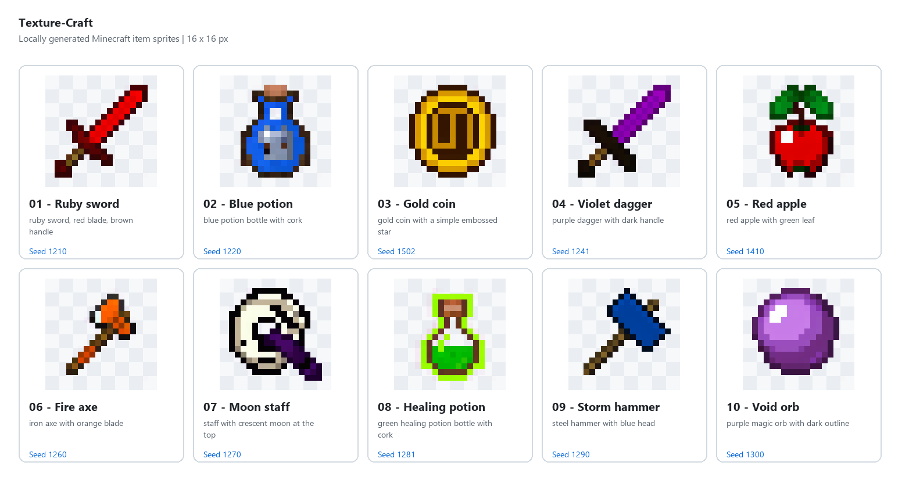

# API Reference

## High-level flow



### Example gallery



## GET /health

Returns engine and GPU status.

```json
{
  "status": "ready",
  "device": "cuda",
  "cuda_available": true,
  "gpu_name": "NVIDIA RTX 4070",
  "vram_total_gb": 12.0,
  "vram_allocated_gb": 1.2,
  "model_path": "models/minecraft-item-16px"
}
```

## POST /v1/textures/generate

Generate one or more 16x16 transparent textures from a prompt.

The engine removes the model's magenta chroma-key and attempts to remove other flat or repeating backgrounds that connect to the image corners. Background removal is heuristic; complex backgrounds or items touching the corners may need manual cleanup.

Request body:

```json
{
  "prompt": "ruby broadsword with glowing runes",
  "negative_prompt": "blurry, low quality",
  "variants": 2,
  "seed": 42,
  "steps": 30,
  "guidance_scale": 9.0
}
```

Response:

```json
{
  "prompt": "ruby broadsword with glowing runes",
  "count": 2,
  "results": [
    {
      "variant_index": 1,
      "seed": 42,
      "latency_sec": 1.4,
      "base64_png": "...",
      "data_uri": "data:image/png;base64,..."
    }
  ]
}
```

## Example usage flow

```bash
curl -X POST http://127.0.0.1:8000/v1/textures/generate \
  -H "Content-Type: application/json" \
  -d '{
    "prompt": "frost potion with blue crystal glow",
    "variants": 3,
    "seed": 77,
    "steps": 30,
    "guidance_scale": 9.0
  }'
```

This is useful when you want to generate several candidate item textures for a UI mockup, a plugin idea, or an AI asset pipeline before choosing the best result.
