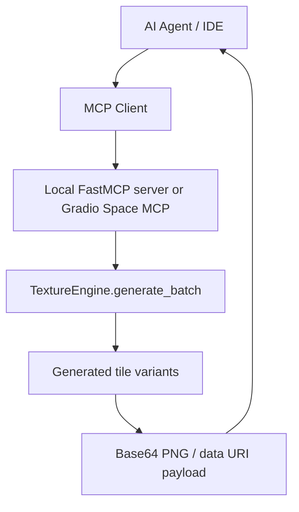
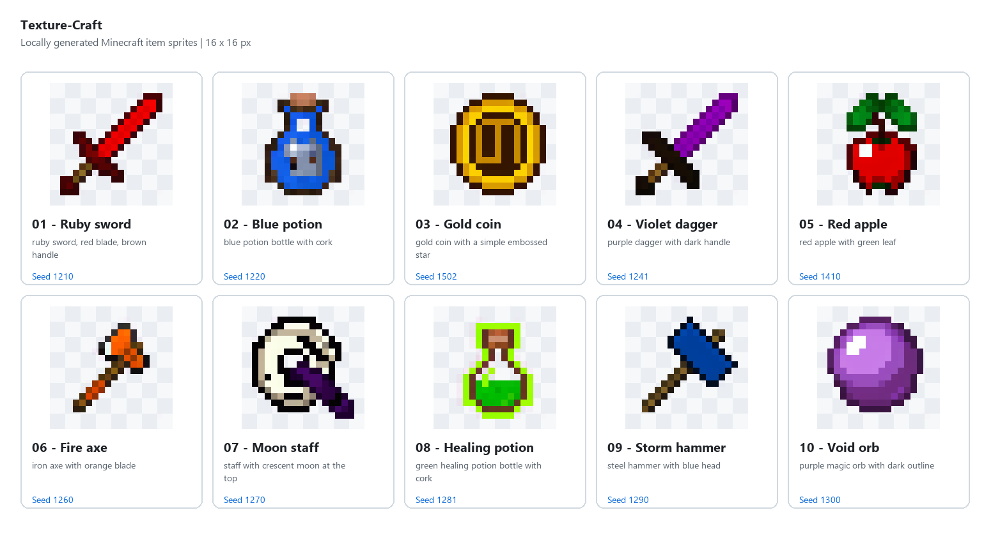

# MCP Integration

Texture-Craft exposes a single MCP tool: `generate_texture`.



### Example texture set



```json
{
  "mcpServers": {
    "texture-craft": {
      "command": "C:\\path\\to\\Texture-Craft\\.venv\\Scripts\\python.exe",
      "args": ["C:\\path\\to\\Texture-Craft\\local_mcp_server.py"]
    }
  }
}
```

For the local stdio workflow, `texture-craft-mcp` runs the FastMCP server. The REST API remains available through `python server.py`. The Hugging Face deployment uses `app.py` and Gradio's built-in MCP server; it does not start a separate FastMCP service.

The tool accepts typed arguments:

- `prompt`
- `variants` (1–4)
- `seed` (-1 for random or an integer from 0 to 2147483647)
- `steps` (10–50)
- `guidance_scale` (3–15)

Example payload:

```json
{
  "prompt": "golden wand with arcane sparkles",
  "variants": 2,
  "seed": 42,
  "steps": 30,
  "guidance_scale": 9.0
}
```

Example response:

```json
{
  "prompt": "golden wand with arcane sparkles",
  "count": 2,
  "textures": [
    {
      "variant_index": 1,
      "seed": 42,
      "latency_sec": 1.8,
      "filename": "texture-01.png",
      "mime_type": "image/png",
      "base64_png": "...",
      "data_uri": "data:image/png;base64,..."
    }
  ]
}
```

The Hugging Face Space MCP endpoint is `https://<owner>-<space-name>.hf.space/gradio_api/mcp/`. The public tool schema is at `/gradio_api/mcp/schema`; deployment instructions and verification steps are in [Hugging Face Space deployment](./HUGGING_FACE_SPACE.md).